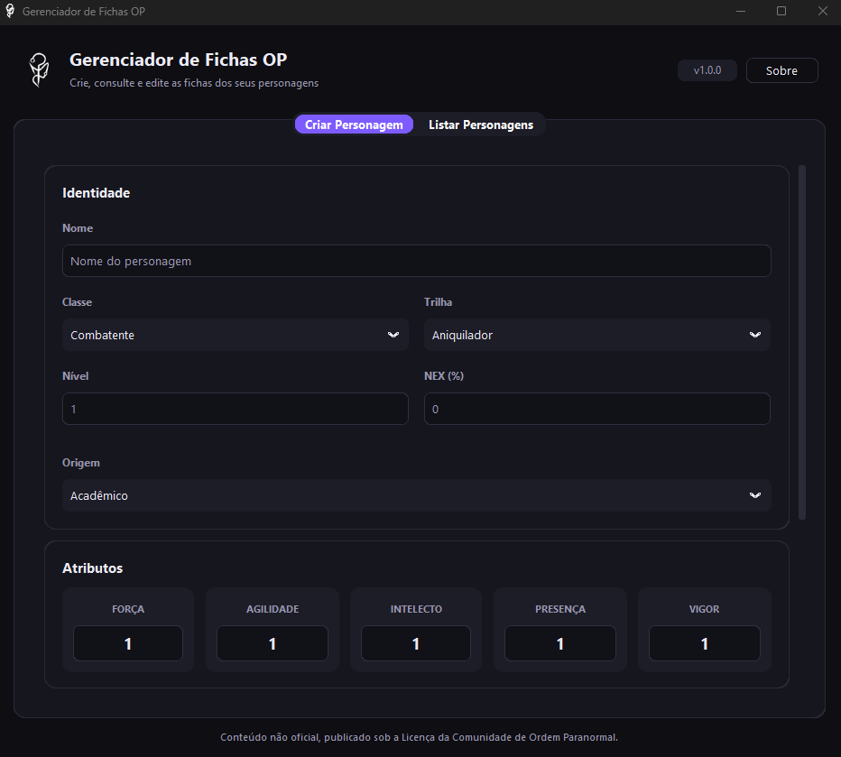

# Gerenciador de Fichas OP

App de Windows para criar, consultar e editar fichas de personagens de **Ordem Paranormal RPG**.



## Baixar

**[Baixe a versão mais recente](https://github.com/edricls/gerenciador_fichas_op/releases/latest)**: em *Assets*, escolha o arquivo `GerenciadorFichasOP-<versão>-Setup.exe`.

Abra o instalador e siga os passos. Não é preciso ser administrador nem instalar o Python. O app aparece no Menu Iniciar como **Gerenciador de Fichas OP**. Requer Windows 10 ou 11 (64 bits).

> **O Windows mostrou "O Windows protegeu o computador"?**
> É normal em apps independentes, que não têm uma assinatura digital paga. Clique em **Mais informações** e depois em **Executar assim mesmo**.

## O que o app faz

- Criação de personagens com classe, trilha, origem, NEX, patente e atributos
- Cálculo de PV, PD, PD por turno, Defesa e deslocamento, com opção de ajustar os valores à mão
- Perícias, habilidades e rituais customizáveis
- Inventário com controle de peso e limite por categoria
- Foto do personagem, com ajuste de enquadramento
- Modo claro e escuro, acompanhando o tema do Windows

### Onde ficam as fichas

As fichas e fotos ficam em `%APPDATA%\Gerenciador de Fichas OP`. O botão **Sobre → Abrir pasta de dados** leva direto até lá. Para fazer backup, basta copiar essa pasta.

Desinstalar ou atualizar o app **não apaga** as fichas.

## Para desenvolvedores

### Rodar a partir do código

Requer Python 3.14 (a versão usada no desenvolvimento).

```powershell
python -m venv .venv
.venv\Scripts\activate
pip install -r requirements.txt
python -m app.main
```

Na primeira execução, se houver um `fichas_op.db` (ou o antigo `rpg.db`) e uma pasta `imagens/` na raiz do projeto, eles são **copiados** para a pasta de dados. Os originais ficam como backup.

### Testes

```powershell
python -m unittest discover -s tests
```

### Gerar o instalador

Requer também o [Inno Setup 6](https://jrsoftware.org/isdl.php).

```powershell
pip install -r requirements-dev.txt
powershell -ExecutionPolicy Bypass -File build.ps1
```

O `build.ps1` roda os testes, gera o executável com o PyInstaller (`GerenciadorFichasOP.spec`) e depois o instalador com o Inno Setup (`instalador/GerenciadorFichasOP.iss`). O resultado fica em `dist\GerenciadorFichasOP-<versão>-Setup.exe`.

Para lançar uma nova versão, altere `__version__` em `app/__init__.py`. O instalador e a janela *Sobre* usam esse número.

### Organização do código

| Arquivo | Responsabilidade |
|---|---|
| `app/main.py` | Ponto de entrada |
| `app/gui.py` | Interface (CustomTkinter) |
| `app/theme.py` | Cores, fontes e estilos |
| `app/gui_data.py` | Dados do sistema: classes, trilhas, origens, perícias, patentes |
| `app/character_rules.py` | Regras de cálculo da ficha |
| `app/models.py`, `app/database.py` | Banco SQLite (SQLAlchemy) |
| `app/*_storage.py` | Leitura e gravação de personagens, perícias, inventário e fotos |
| `app/caminhos.py` | Pasta de dados do usuário e migração de versões antigas |
| `app/icone.py` | Ícone do app (símbolo do Medo) |

## Licença

O código é distribuído sob a [Licença Apache 2.0](LICENSE).

Este é um conteúdo não oficial, publicado sob a Licença da Comunidade de Ordem Paranormal. Ordem Paranormal RPG é propriedade intelectual de Rafael "Cellbit" Lange e Jambô Editora.
